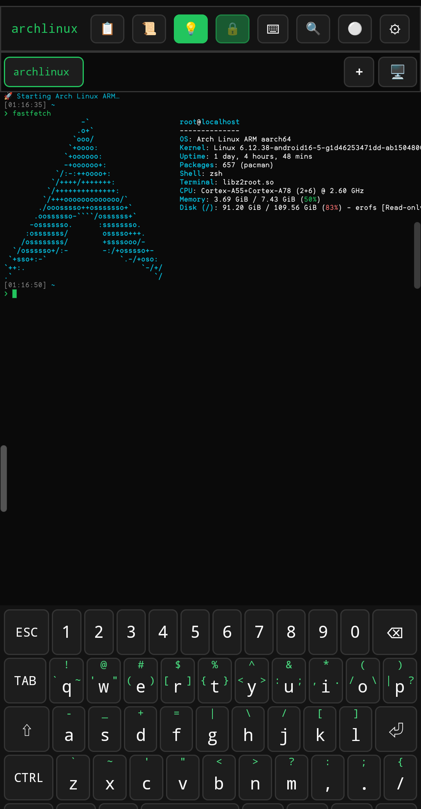
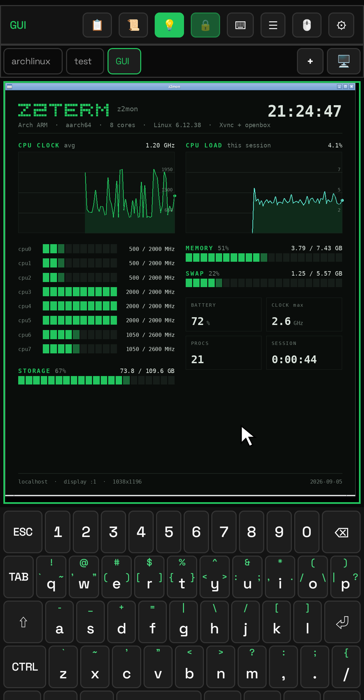
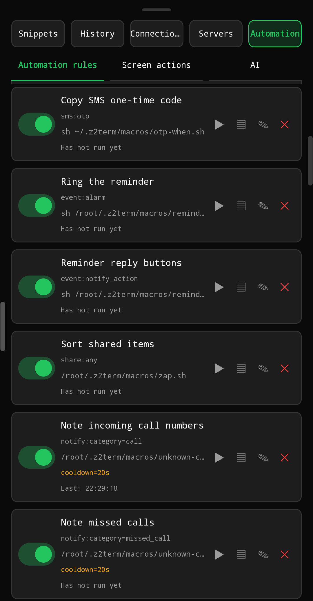
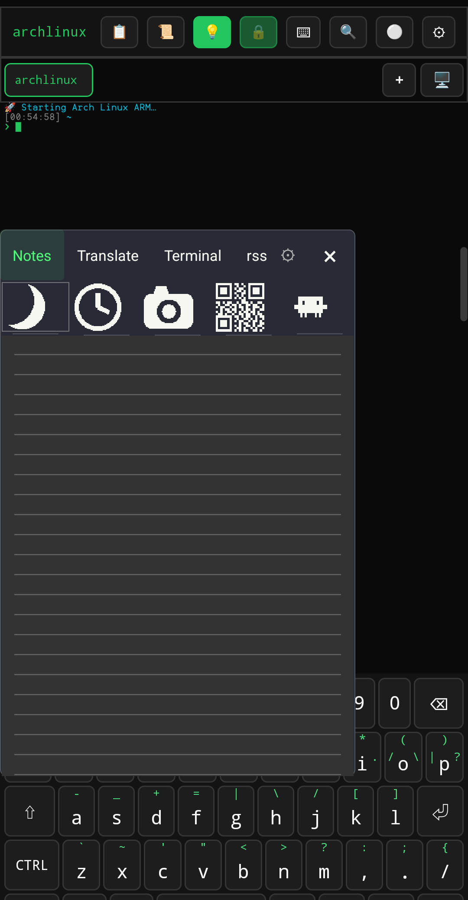

# Z2Term — Zero 2 Terminal

[English](README.md) ・ **日本語**

[](https://github.com/orgsonai/z2term/releases/latest)
[](LICENSE)


**スマホの中で Linux が動くターミナル。しかも、そのシェルからスマホそのものを操作できます。** root 不要、APK 1 つで動きます。

**[ダウンロード（GitHub Releases）](https://github.com/orgsonai/z2term/releases/latest)** ・ **[F-Droid](https://f-droid.org/packages/com.zerotoship.z2term/)** ・ **[ブラウザで試す](https://orgsonai.github.io/z2term/index.ja.html)**（インストール不要。ブラウザの中のスマホの見本で、そのまま触れます）

## できること

```
z2term
├── ターミナル
│   ├── Linux ................. Alpine / Ubuntu / Arch / Kali（root 不要）
│   ├── GUI ................... Linux のデスクトップをタブで開き、Linux のアプリを起動
│   └── タブ .................. 分割表示、ブロードキャストで複数のタブへ同時に入力
├── 接続
│   ├── サーバー .............. SSH・SFTP・SMB・FTP・WebDAV
│   ├── リモート画面 .......... VNC・RDP
│   └── 機器 .................. USB シリアル、Wi-Fi 越しのシリアル
├── 自動化
│   ├── きっかけで実行 ........ 充電・時刻・Wi-Fi・SMS・通知などで、スクリプトを動かす
│   ├── 画面操作マクロ ........ タップやスワイプを記録して再生
│   └── AI に任せる ........... AI がほかのアプリの画面や、シリアルの機器を操作（MCP）
├── Android を便利に
│   ├── エッジパネル .......... 画面の端から、コマンドやアプリを呼ぶ
│   ├── タイル・ウィジェット .. クイック設定とホーム画面からマクロを実行
│   └── アイコン .............. 通知やタイルのアイコンを自分で描く
└── 日本語入力
    ├── かな漢字変換 .......... 予測・学習つき
    └── OS のキーボード ....... ほかのアプリでも同じキーボードで打てる

土台: z2-* コマンド ── 上のすべてを、シェルの 1 行から
```

## たとえば、こんなことができます

- PC の前に行かずに、スマホから自宅のサーバーへ SSH で入って直す
- 充電を始めたら自動でバックアップを取り、終わったら通知する
- 毎朝アプリを開いて同じボタンを押す作業を、マクロで自動にする
- API の無いアプリの操作を、AI に頼む
- Wi-Fi 越しに、ルーターやマイコンのコンソールを操作する（ケーブル不要）
- スマホから PC へキーボードとして打ち込む。ログイン前の画面にも打てる（Raspberry Pi Pico を使う例つき）
- Linux のデスクトップアプリを、スマホのタブの中で動かす

## z2-* コマンド: スマホの機能を、シェルの 1 行で

ふつうはアプリのボタンでしかできないことが、コマンドでできます。約 40 個あり、`z2help` で一覧が出ます。

| やりたいこと | コマンド |
|---|---|
| 通知を出す | `z2-notify "ビルドが終わりました"` |
| 通知で質問して、答えを受け取る | `name=$(z2-ask "ブランチ名は？")` |
| ライトを点ける | `z2-torch on` |
| 電池の状態を読む | `z2-battery` |
| しゃべらせる | `z2-say "おはようございます"` |
| クリップボードに入れる | `z2-clip set "コピーする文字"` |

組み合わせると、スマホの出来事で Linux のスクリプトを動かせます。

```sh
# 充電を始めたら、バックアップを取って、終わったら通知する
z2-when charge:start run '~/backup.sh && z2-notify "バックアップ完了"'
```

アプリを開いていなくても、再起動をまたいでも動き続けます。

## 画面

<table>
  <tr>
    <td align="center" width="25%"><br><sub>ターミナル</sub></td>
    <td align="center" width="25%"><br><sub>Linux のデスクトップ<br>（モニター: <a href="examples/z2mon.py">z2mon</a>）</sub></td>
    <td align="center" width="25%"><br><sub>自動化ルール</sub></td>
    <td align="center" width="25%"><br><sub>エッジパネル</sub></td>
  </tr>
</table>

## Termux との違い

Android のターミナルで、いちばん多くのパッケージと実績が欲しいなら Termux が正解です。Z2Term は、**ターミナルをスマホを操作する手段にして、APK 1 つで完結させる**ことを目指しています。

| | Z2Term | Termux + アドオン群 |
|---|---|---|
| Linux ディストロ | Alpine / Ubuntu / Arch / Kali を導入可 | `proot-distro` で導入 |
| Linux の GUI | アプリ内の GUI タブ（音声・動画つき）。同じビューアでリモートの VNC / RDP も開ける | 別の X11 / VNC / RDP ビューアアプリ |
| シェルから Android を操作 | 内蔵（約 40 個の `z2-*`） | 別のアプリが必要 |
| イベントで自動実行 | 内蔵（`z2-when`）。自動化タブ・実行の記録・一括停止つき | 別のアプリ。多くは市販の自動化アプリと併用 |
| 日本語入力 | IME を内蔵。OS のキーボードとしても選べる | OS のキーボード |
| SSH / SFTP・FTP・WebDAV・SMB と `sshd` | 内蔵。SSH の鍵は Android Keystore が持つ | 自分でパッケージを入れる |

どちらも GPL-3.0 で、どちらも利用状況を集めません。

## ダウンロードと更新

- **GitHub Releases**: <https://github.com/orgsonai/z2term/releases/latest> から `z2term-<版数>.apk` を落としてタップします（「提供元不明のアプリ」の許可が要ります）。Google Play では配布していません。
- **F-Droid**: <https://f-droid.org/packages/com.zerotoship.z2term/>。F-Droid がソースからビルドし、F-Droid の鍵で署名しています。⚠ GitHub の APK とは署名が違うので、上書きはできません（乗り換えるときは一度アンインストールします。Linux 環境も消えます）。

初回は ⚙設定 › Linux環境 から使う OS を選んで取得します（公式の配布元から取得し、SHA-256 で検証します）。アプリを更新しても OS は取り直しません。

更新は、合うものを選んでください。
- **アプリ内で**: 設定 → アプリ情報 → 更新を確認。ボタンを押したときだけ GitHub に問い合わせます。端末からは `z2-update`。
- **F-Droid**: F-Droid から入れた場合は F-Droid で。
- **自動で**: [Obtainium](https://github.com/ImranR98/Obtainium) に `https://github.com/orgsonai/z2term` を登録すると、新しい版をワンタップで入れられます。

## 詳しい説明

- [説明書（HANDBOOK）](docs/ja/HANDBOOK.md) ── 使い方のすべて
- [機能の一覧](docs/ja/FEATURES.md) ── できることを 1 つの一覧に
- [AI に操作させる](docs/ja/AI-BRIDGE.md) ・ [画面操作のマクロ](docs/ja/ACTION-MACROS.md)
- [更新履歴](docs/ja/CHANGELOG.md)
- [ビルドの方法](docs/ja/BUILD.md)

## ライセンス

このプロジェクトのために書いたもの — アプリ本体 (`app/src/main/java/**`)、実行エンジンを含むネイティブコード (`app/src/main/cpp/**`)、このリポジトリのスクリプトと文書 — のライセンスは、すべて **GPL-3.0-only** です。
Copyright (c) 2026 Zero to Ship。対応ソース（GPL v3 §6）: <https://github.com/orgsonai/z2term>（ルートの `LICENSE` に全文）。
同梱する第三者コンポーネントは設定画面の「OSSライセンス」で確認できます。

## 同梱 OSS と対応ソース

| 同梱物 | ライセンス | 対応ソース取得方法 |
|---|---|---|
| ZXing Core 3.5.3 | Apache-2.0 | [zxing/zxing 3.5.3](https://github.com/zxing/zxing/tree/zxing-3.5.3) |
| ZXing Android Embedded 4.3.0 | Apache-2.0 | [journeyapps/zxing-android-embedded v4.3.0](https://github.com/journeyapps/zxing-android-embedded/tree/v4.3.0) |
| AndroidX / Jetpack Compose | Apache-2.0 | [Android Open Source Project](https://android.googlesource.com/) |
| Kotlin Standard Library / Coroutines 1.7.3 | Apache-2.0 | [JetBrains/kotlin](https://github.com/JetBrains/kotlin) / [kotlinx.coroutines 1.7.3](https://github.com/Kotlin/kotlinx.coroutines/tree/1.7.3) |
| JSch / JZlib / jBCrypt | BSD-3-Clause / ISC | [mwiede/jsch](https://github.com/mwiede/jsch) / [ymnk/jzlib](https://github.com/ymnk/jzlib) / [jBCrypt](https://www.mindrot.org/projects/jBCrypt/) |
| usb-serial-for-android 3.12.0 | MIT | [mik3y/usb-serial-for-android 3.12.0](https://github.com/mik3y/usb-serial-for-android/tree/3.12.0) |
| OkHttp 5.3.0 | Apache-2.0 | [square/okhttp](https://github.com/square/okhttp) |
| Okio 3.16.2 | Apache-2.0 | [square/okio 3.16.2](https://github.com/square/okio/tree/3.16.2) |
| SMBJ 0.15.0 | Apache-2.0 | [hierynomus/smbj v0.15.0](https://github.com/hierynomus/smbj/tree/v0.15.0) |
| asn-one 0.6.0 | Apache-2.0 | [hierynomus/asn-one v0.6.0](https://github.com/hierynomus/asn-one/tree/v0.6.0) |
| MBassador 1.3.2 | MIT | [bennidi/mbassador](https://github.com/bennidi/mbassador) |
| SLF4J API 2.0.18 | MIT | [qos-ch/slf4j v2.0.18](https://github.com/qos-ch/slf4j/tree/v_2.0.18) |
| Bouncy Castle 1.85.2 | MIT | [bcgit/bc-java r1rv85v2](https://github.com/bcgit/bc-java/tree/r1rv85v2) |
| XZ for Java | 0BSD | [Tukaani XZ for Java](https://tukaani.org/xz/java.html) |
| Guava ListenableFuture 1.0 | Apache-2.0 | [google/guava](https://github.com/google/guava) |
| JetBrains Java Annotations 23.0.0 | Apache-2.0 | [JetBrains/java-annotations](https://github.com/JetBrains/java-annotations) |
| Fira Code / IBM Plex Mono / JetBrains Mono | OFL-1.1 | [tonsky/FiraCode](https://github.com/tonsky/FiraCode) / [IBM/plex](https://github.com/IBM/plex) / [JetBrains/JetBrainsMono](https://github.com/JetBrains/JetBrainsMono) |
| Z2 Mono（このアプリのために作ったフォント。生成スクリプトは `scripts/z2-mono/`） | OFL-1.1 | このリポジトリ |
| SKK-JISYO.L（同梱辞書 `z2dict.txt` の原本） | GPL-2.0-or-later | [skk-dev/dict](https://github.com/skk-dev/dict) |
| IPADIC（mecab-ipadic 2.7.0-20070801。`kkc_lex.tsv` / `kkc_matrix.bin` / `kkc_names.tsv` の元） | NAIST ライセンス | [taku910/mecab](https://github.com/taku910/mecab) |
| 日本語版ウィキペディア（共起データ `kkc_colloc.bloom`・頻度補正 `kkc_freq.tsv`・補完用の語 `kkc_predict.tsv`・次の語 `kkc_next.tsv` の元） | CC BY-SA 4.0 | [jawiki ダンプ](https://dumps.wikimedia.org/jawiki/) |

設定画面 →「OSS ライセンス / 対応ソース」から、上記情報をアプリ内でも一覧/全文表示できます
（`assets/licenses/` にライセンス全文を配置）。

## 配布方針

| チャネル | 状況 |
|---|---|
| **GitHub Releases / 直接 APK 配布** | 主たる配布経路。1 リリースにつき APK 1 つ |
| **F-Droid** | 配信中。F-Droid の鍵で署名: <https://f-droid.org/packages/com.zerotoship.z2term/>。rootfs は実行時取得、実行エンジンはソースビルド（`docs/FDROID.md`）|
| **Google Play** | 配布予定なし |

## SSH サーバ (sshd) の既定挙動

端末内 `sshd` コマンドは既定で **127.0.0.1 限定 bind + 鍵認証のみ** で起動します
（dropbear wrapper、`SshdScript.kt`）。LAN/WAN 公開する場合は明示的に:

```sh
sshd --lan          # 全 NIC bind、~/.ssh/authorized_keys が空だと起動拒否
Z2_SSHD_LAN=1 sshd  # env でも可
```

## 関連

- [Zero to Ship Project](https://github.com/orgsonai)
- [Termux](https://github.com/termux/termux-app) - 参考実装
- z2root — 本リポジトリでソースビルドするユーザー空間Linuxエンジン
- [Alpine Linux](https://alpinelinux.org/) - メインディストロ
