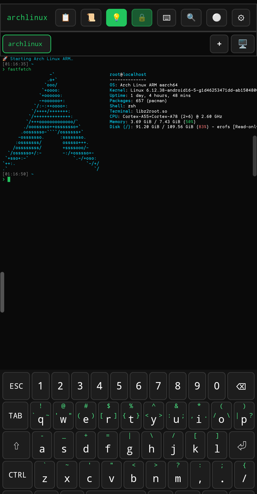
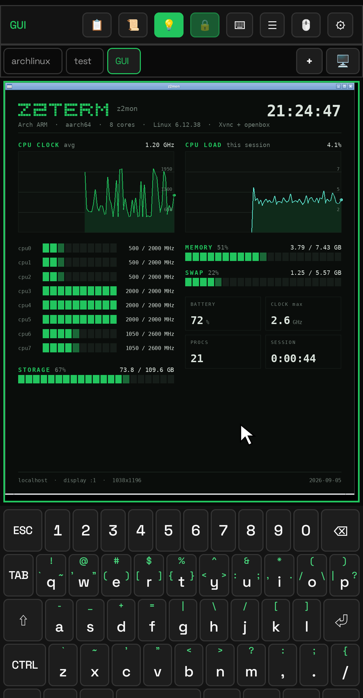
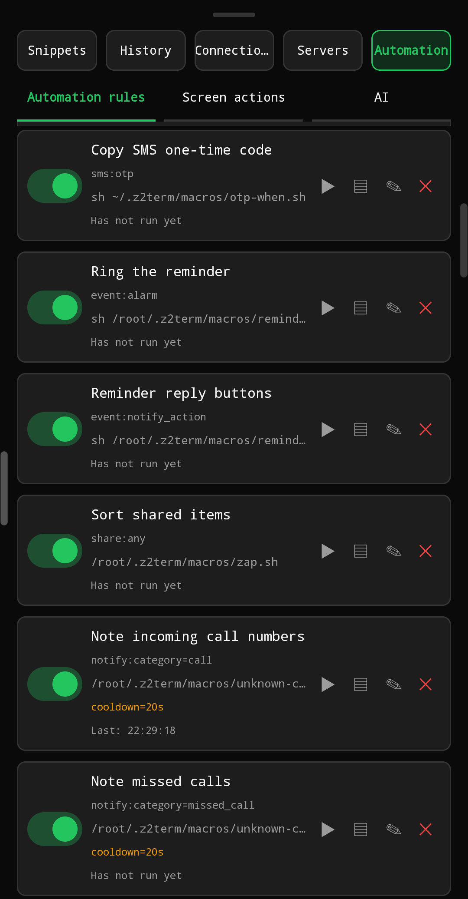
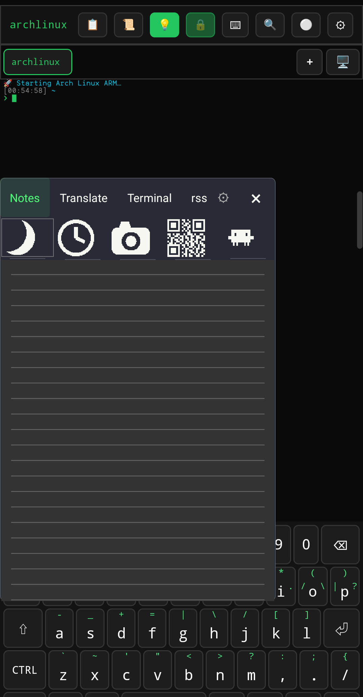

# Z2Term — Zero 2 Terminal

**English** ・ [日本語](README.ja.md)

[](https://github.com/orgsonai/z2term/releases/latest)
[](LICENSE)


**A terminal that runs Linux on your phone, and whose shell can drive the phone itself.** No root; one APK.

**[Download (GitHub Releases)](https://github.com/orgsonai/z2term/releases/latest)** · **[F-Droid](https://f-droid.org/packages/com.zerotoship.z2term/)** · **[Try it in your browser](https://orgsonai.github.io/z2term/)** (nothing to install: a phone mock-up in the page runs it as it is)

## What it can do

```
z2term
├── Terminal
│   ├── Linux ............ Alpine / Ubuntu / Arch / Kali, no root
│   ├── GUI .............. a Linux desktop in a tab; launch Linux apps
│   └── Tabs ............. split view; broadcast one input to several tabs
├── Connect
│   ├── Servers .......... SSH, SFTP, SMB, FTP, WebDAV
│   ├── Remote screens ... VNC, RDP
│   └── Devices .......... USB serial, serial over Wi-Fi
├── Automate
│   ├── Triggers ......... run scripts on charging, time, Wi-Fi, SMS, notifications ...
│   ├── Screen macros .... record taps and swipes, play them back
│   └── AI ............... let an AI operate other apps and serial devices (MCP)
├── Android, handier
│   ├── Edge panels ...... commands and apps from the edge of the screen
│   ├── Tiles, widgets ... run macros from quick settings and the home screen
│   └── Icons ............ draw your own notification and tile icons
└── Japanese input
    ├── Kana-kanji ....... conversion with prediction and learning
    └── System keyboard .. the same keyboard in every app

Underneath it all: z2-* commands, every item above from one line of shell
```

## Things you can do with it

- Fix your home server over SSH from the phone, without walking to the PC
- Start a backup when you plug in the charger and get a notification when it is done
- Turn "open the app every morning and press the same buttons" into a macro
- Ask an AI to work an app for you, even one with no API
- Reach the console of a router or a microcontroller over Wi-Fi, no cable needed
- Type into a PC from the phone, even on its login screen (example with a Raspberry Pi Pico included)
- Run a Linux desktop app inside a tab on the phone

## z2-* commands: the phone, from one line of shell

Things that normally take an app's buttons become commands. There are about 40; `z2help` lists them.

| To | Run |
|---|---|
| Post a notification | `z2-notify "Build finished"` |
| Ask in the notification shade and get the answer | `name=$(z2-ask "Branch name?")` |
| Turn on the torch | `z2-torch on` |
| Read the battery | `z2-battery` |
| Speak | `z2-say "Good morning"` |
| Copy to the clipboard | `z2-clip set "some text"` |

Put together, events on the phone run Linux scripts:

```sh
# when charging starts, back up, then post a notification
z2-when charge:start run '~/backup.sh && z2-notify "Backup finished"'
```

It keeps working with the app closed and across reboots.

## Screens

<table>
  <tr>
    <td align="center" width="25%"><br><sub>Terminal</sub></td>
    <td align="center" width="25%"><br><sub>Linux desktop</sub></td>
    <td align="center" width="25%"><br><sub>Automation rules</sub></td>
    <td align="center" width="25%"><br><sub>Edge panel</sub></td>
  </tr>
</table>

## Compared with Termux

If you want the largest package repository and the most battle-tested tooling on Android, Termux is the right answer. Z2Term aims at something else: **a terminal that is a way to operate the phone, all in one APK.**

| | Z2Term | Termux + its add-ons |
|---|---|---|
| Linux distribution | Alpine / Ubuntu / Arch / Kali | `proot-distro` installs one |
| Linux GUI | A GUI tab inside the app, with audio and video. The same viewer opens remote VNC / RDP desktops | A separate X11, VNC or RDP viewer app |
| Drive Android from the shell | Built in (~40 `z2-*` helpers) | A separate companion app |
| Run on device events | Built in (`z2-when`), with an Automation tab, run logs and a kill switch | A separate companion app, usually with a third-party automation app |
| Japanese input | Built-in IME, also selectable as the system keyboard | The OS keyboard |
| SSH / SFTP, FTP, WebDAV, SMB and `sshd` | Built in; SSH keys held by the Android Keystore | Install the packages yourself |

Both are GPL-3.0 and neither collects telemetry.

## Download and updates

- **GitHub Releases**: download `z2term-<version>.apk` from <https://github.com/orgsonai/z2term/releases/latest> and tap it (allow "Install unknown apps"). Not distributed on Google Play.
- **F-Droid**: <https://f-droid.org/packages/com.zerotoship.z2term/>. F-Droid builds it from source and signs it with its own key. ⚠ The signature differs from the GitHub APK, so one cannot be installed over the other (uninstall first to switch; this removes the Linux environment too).

On first launch, pick a distribution in Settings › Linux environment (fetched from the official source and verified by SHA-256). App updates never download it again.

To update, pick whichever fits:
- **In the app**: Settings → App info → Check for updates. It asks GitHub only when you tap the button. From the terminal: `z2-update`.
- **F-Droid**: if you installed from F-Droid, update there.
- **Automatically**: add `https://github.com/orgsonai/z2term` to [Obtainium](https://github.com/ImranR98/Obtainium) to install new versions with one tap.

## Documentation

- [Handbook](docs/en/HANDBOOK.md): how to use everything
- [Feature list](docs/en/FEATURES.md): everything it does, in one list
- [Let an AI operate it](docs/en/AI-BRIDGE.md) · [Screen macros](docs/en/ACTION-MACROS.md)
- [Changelog](docs/en/CHANGELOG.md)
- [Building](docs/en/BUILD.md)

## License

Everything written for this project — the app (`app/src/main/java/**`), the native code including the execution engine (`app/src/main/cpp/**`), and the scripts and docs in this repository — is licensed under **GPL-3.0-only**.
Copyright (c) 2026 Zero to Ship. Corresponding source (GPL v3 §6): <https://github.com/orgsonai/z2term> (full text in the root `LICENSE`).
Bundled third-party notices are available from Settings → OSS licenses.

## Bundled OSS and corresponding source

| Bundled item | License | How to get the corresponding source |
|---|---|---|
| ZXing Core 3.5.3 | Apache-2.0 | [zxing/zxing 3.5.3](https://github.com/zxing/zxing/tree/zxing-3.5.3) |
| ZXing Android Embedded 4.3.0 | Apache-2.0 | [journeyapps/zxing-android-embedded v4.3.0](https://github.com/journeyapps/zxing-android-embedded/tree/v4.3.0) |
| AndroidX / Jetpack Compose | Apache-2.0 | [Android Open Source Project](https://android.googlesource.com/) |
| Kotlin Standard Library / Coroutines 1.7.3 | Apache-2.0 | [JetBrains/kotlin](https://github.com/JetBrains/kotlin) / [kotlinx.coroutines 1.7.3](https://github.com/Kotlin/kotlinx.coroutines/tree/1.7.3) |
| JSch / JZlib / jBCrypt | BSD-3-Clause / ISC | [mwiede/jsch](https://github.com/mwiede/jsch) / [ymnk/jzlib](https://github.com/ymnk/jzlib) / [jBCrypt](https://www.mindrot.org/projects/jBCrypt/) |
| usb-serial-for-android 3.12.0 | MIT | [mik3y/usb-serial-for-android 3.12.0](https://github.com/mik3y/usb-serial-for-android/tree/3.12.0) |
| OkHttp 5.3.0 | Apache-2.0 | [square/okhttp](https://github.com/square/okhttp) |
| Okio 3.16.2 | Apache-2.0 | [square/okio 3.16.2](https://github.com/square/okio/tree/3.16.2) |
| SMBJ 0.15.0 | Apache-2.0 | [hierynomus/smbj v0.15.0](https://github.com/hierynomus/smbj/tree/v0.15.0) |
| asn-one 0.6.0 | Apache-2.0 | [hierynomus/asn-one v0.6.0](https://github.com/hierynomus/asn-one/tree/v0.6.0) |
| MBassador 1.3.2 | MIT | [bennidi/mbassador](https://github.com/bennidi/mbassador) |
| SLF4J API 2.0.18 | MIT | [qos-ch/slf4j v2.0.18](https://github.com/qos-ch/slf4j/tree/v_2.0.18) |
| Bouncy Castle 1.85.2 | MIT | [bcgit/bc-java r1rv85v2](https://github.com/bcgit/bc-java/tree/r1rv85v2) |
| XZ for Java | 0BSD | [Tukaani XZ for Java](https://tukaani.org/xz/java.html) |
| Guava ListenableFuture 1.0 | Apache-2.0 | [google/guava](https://github.com/google/guava) |
| JetBrains Java Annotations 23.0.0 | Apache-2.0 | [JetBrains/java-annotations](https://github.com/JetBrains/java-annotations) |
| Fira Code / IBM Plex Mono / JetBrains Mono | OFL-1.1 | [tonsky/FiraCode](https://github.com/tonsky/FiraCode) / [IBM/plex](https://github.com/IBM/plex) / [JetBrains/JetBrainsMono](https://github.com/JetBrains/JetBrainsMono) |
| Z2 Mono (made for this app; generator in `scripts/z2-mono/`) | OFL-1.1 | this repository |
| SKK-JISYO.L (source of the bundled dictionary `z2dict.txt`) | GPL-2.0-or-later | [skk-dev/dict](https://github.com/skk-dev/dict) |
| IPADIC (mecab-ipadic 2.7.0-20070801; source of `kkc_lex.tsv` / `kkc_matrix.bin` / `kkc_names.tsv`) | NAIST license | [taku910/mecab](https://github.com/taku910/mecab) |
| Japanese Wikipedia (source of the co-occurrence data `kkc_colloc.bloom`, the frequency correction `kkc_freq.tsv`, the completion word list `kkc_predict.tsv` and the next-word list `kkc_next.tsv`) | CC BY-SA 4.0 | [jawiki dumps](https://dumps.wikimedia.org/jawiki/) |

From the settings screen → "OSS licenses / corresponding source", you can also browse/show this in-app
(license full texts are placed in `assets/licenses/`).

## Distribution policy

| Channel | Status |
|---|---|
| **GitHub Releases / direct APK** | Primary channel; one APK per release |
| **F-Droid** | Published, signed with F-Droid's key: <https://f-droid.org/packages/com.zerotoship.z2term/>. Runtime-downloaded rootfs; fully source-built engine (`docs/FDROID.md`) |
| **Google Play** | No distribution planned |

## Default behavior of the SSH server (sshd)

The in-terminal `sshd` command starts by default with **127.0.0.1-only bind + key auth only**
(dropbear wrapper, `SshdScript.kt`). To expose it on LAN/WAN, explicitly:

```sh
sshd --lan          # bind all NICs; refuses to start if ~/.ssh/authorized_keys is empty
Z2_SSHD_LAN=1 sshd  # also works via env
```

## Related

- [Zero to Ship Project](https://github.com/orgsonai)
- [Termux](https://github.com/termux/termux-app) - reference implementation
- z2root — source-built userspace Linux engine included in this repository
- [Alpine Linux](https://alpinelinux.org/) - main distro
